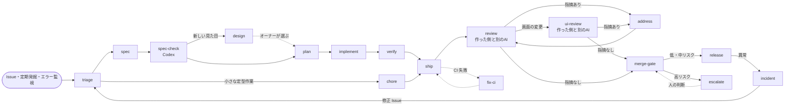

# 自走ワークフロー

Issue が立ってから本番に出るまでを、スキルの連鎖で進めます。各スキルは終わるときに「次に呼ぶスキル」を決め、進行役（Claude Code）がそのまま次へ進みます。人を待つのは escalate だけです。

## 1. 全体の流れ

## 2. スキルの一覧と引き継ぎ

| スキル | いつ動くか | 実行する側 | 次に呼ぶスキル |
| --- | --- | --- | --- |
| triage | Issue が立った・`agent` ラベルが付いた | Claude Code | spec、chore、stack-select（新規アプリ） |
| stack-select | 新しいアプリを始めるとき | Claude Code | design（最初の見た目）→ spec |
| spec | triage の後 | Claude Code | spec-check |
| spec-check | spec の後 | Codex | plan（新しい見た目が要れば design。指摘は spec が反映） |
| design | 新しい種類の画面・デザインのルールの変更・アプリの最初の見た目 | Claude Code | escalate（オーナーが選ぶ）→ plan |
| plan | spec-check の後 | Claude Code | implement |
| implement | plan の後 | Claude Code（`codex` ラベルは Codex） | verify |
| verify | implement の後 | Claude Code | ship（失敗なら implement） |
| ship | verify・chore の後 | 作った側 | review |
| review | PR が開いた・更新された | 作った側と別の AI | address、ui-review（画面の変更）、merge-gate |
| ui-review | 画面・操作が変わる PR | 作った側と別の AI | address、design、merge-gate |
| address | 指摘が付いた | 作った側 | review（2往復まで、超えたら escalate） |
| fix-ci | CI が失敗した | 作った側 | review（3回失敗で escalate） |
| merge-gate | CI とレビューが通った | Claude Code | release、escalate |
| release | main にマージされた | Claude Code（実際のデプロイは GitHub Actions） | 終了、incident |
| incident | 監視が異常を検知した・ロールバックが起きた | Claude Code | triage（修正 Issue） |
| chore | 定期実行・triage から | Codex | ship |
| groom | 毎日の定期実行 | Claude Code | triage（起こした Issue） |
| retro | 毎週の定期実行 | Claude Code | ship（改善 PR） |
| escalate | 決着できないとき | 両方 | 人の判断のあと、元のスキル |

## 3. 起動のきっかけ

| きっかけ | 仕組み | 動くスキル |
| --- | --- | --- |
| Issue に `agent` ラベル、または `@claude` | `.github/workflows/agent.yml`（Claude Code GitHub Actions） | triage から順に |
| triage が Issue に `codex` ラベルを付け、`@codex` とコメント | Codex のクラウドタスク（GitHub 連携）。24時間たっても PR がなければ groom が Claude に引き継ぐ | chore → ship |
| PR が開いた・更新された（Claude が作った PR） | Codex の自動レビュー、`@codex review` | review |
| PR が開いた・更新された（Codex や人が作った PR） | `.github/workflows/claude-code-review.yml`（`claude/` ブランチ以外で動く） | review |
| CI が失敗した | `.github/workflows/agent.yml`（CI 失敗時） | fix-ci |
| 本番のエラー増加 | エラー監視から Issue を自動作成（`incident` ラベル） | incident |
| 毎朝 | Claude Code のルーティン、または `agent.yml` の schedule | groom、`blocked` の再開 |
| 毎週 | Claude Code のルーティン、または `agent.yml` の schedule | retro |

## 4. 状態の残し方

セッションが途中で切れても続きから再開できるように、状態はすべて GitHub に残します。

- 進行中の Issue には `in-progress`、人待ちは `needs-human`、利用上限で保留は `blocked`。
- 各スキルの終わりに、Issue または PR に「やったこと・仮定・確認結果・次に呼ぶスキル」をコメントします。
- 再開するときは、最後のコメントの「次に呼ぶスキル」から始めます。
